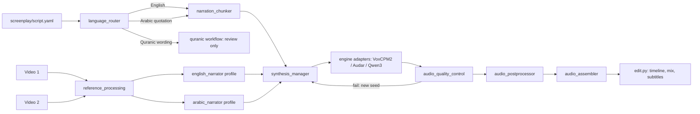

# Voice engine (version 2): installation and usage

Version 2 of the film uses two cloned narrators:

- **English narrator** (`voice_profiles/english_narrator/`), cloned from Video 1. It reads all English narration.
- **Arabic narrator** (`voice_profiles/arabic_narrator/`), cloned from Video 2. It reads the original Arabic of the classical quotations and hadith on screen.
- **Quranic workflow.** Quranic text (and any quotation that contains Quranic wording) goes to a separate review workflow. It is never approved automatically and never mixed into the film until a qualified reviewer approves it.

The code is in `audio_engine/` and the configuration in `configuration/voice_config.yaml`. The film editor (`scripts/editing/edit.py`) reads the assembled segments from `assets/narration/segments/`.



## 1. Hardware and environments

The engine runs on CPU. It was built on a 4-vCPU Linux container with 15 GiB RAM. VoxCPM2 needs about 11.5 GB of RAM while it generates, so do not run another model at the same time.

| venv (in `/home/user/iram-work/venvs/`) | Python | Contents | Used for |
|---|---|---|---|
| `voxcpm` | 3.12 | `voxcpm==2.0.3`, `torch==2.15.0` | VoxCPM2 worker |
| `audar` | 3.12 | `torch==2.15.0`, `transformers>=4.57`, `neucodec`, `librosa` | Audar-TTS-V1-Flash worker |
| `qwen` | 3.12 | `qwen-tts==0.1.1` | Qwen3-TTS worker (version 1 engine, English only) |
| `ml` | 3.12 | Whisper, transformers, librosa, pyloudnorm, `nara_wpe` | the manager, QA, reports and the editor |

```bash
cd /home/user/iram-work/venvs
uv venv -p 3.12 voxcpm && VIRTUAL_ENV=$PWD/voxcpm uv pip install "voxcpm==2.0.3" "torch==2.15.0" torchaudio
uv venv -p 3.12 audar  && VIRTUAL_ENV=$PWD/audar  uv pip install "torch==2.15.0" torchaudio "transformers>=4.57" neucodec soundfile librosa numpy
VIRTUAL_ENV=$PWD/ml uv pip install nara_wpe
```

### Model weights (in `/home/user/iram-work/models/`)

| Folder | Hugging Face repository | Size | Licence |
|---|---|---|---|
| `voxcpm2/` | `openbmb/VoxCPM2` | 5.0 GB | Apache-2.0 |
| `audar-flash/transformers/` | `audarai/Audar-TTS-V1-Flash` (subfolder `transformers/`) | 1.1 GB | AudarAI Open License v1.0 |
| `neucodec/` | `neuphonic/neucodec` (**gated**: accept the terms while logged in) | 2.5 GB | Apache-2.0 |
| `whisper-large-v3-turbo/` | `openai/whisper-large-v3-turbo` | 1.6 GB | MIT |
| `wavlm-base-plus-sv/` | `microsoft/wavlm-base-plus-sv` | 0.4 GB | MIT (model card) |

```bash
HF=/home/user/iram-work/venvs/ml/bin/hf; cd /home/user/iram-work/models
$HF download openbmb/VoxCPM2 --local-dir voxcpm2
$HF download audarai/Audar-TTS-V1-Flash --include "transformers/*" --local-dir audar-flash
$HF download neuphonic/neucodec --local-dir neucodec          # needs an accepted gate and a token
$HF download openai/whisper-large-v3-turbo model.safetensors config.json generation_config.json preprocessor_config.json \
    tokenizer.json tokenizer_config.json vocab.json merges.txt normalizer.json added_tokens.json special_tokens_map.json --local-dir whisper-large-v3-turbo
$HF download microsoft/wavlm-base-plus-sv --local-dir wavlm-base-plus-sv
```

To get NeuCodec, open huggingface.co/neuphonic/neucodec while you are logged in and accept the terms. Then make a read token available to the downloader (in this cloud environment: a network secret for `huggingface.co`). Never put the token in a command line or a file in the repository.

### Apple Silicon Mac

- VoxCPM2 chooses its device automatically (CUDA, then MPS, then CPU). The worker forces `device='cpu'`. On a Mac, change it to `'mps'` in `audio_engine/engines/workers/voxcpm_worker.py`, then test: MPS support depends on the PyTorch version.
- Audar-Flash (transformers) runs on CPU or MPS in float32. The GGUF build (llama.cpp, Metal) is a faster option on a Mac. It also needs NeuCodec.
- Use 16 GB of unified memory or more for VoxCPM2.

## 2. Commands (run from the `iram-documentary/` folder)

```bash
PY=/home/user/iram-work/venvs/ml/bin/python
# 1. references (keeps the originals unchanged; writes transcript, metadata, cleaned clip)
$PY -m audio_engine.reference_processing --profile english --video <Video1.mp4>
$PY -m audio_engine.reference_processing --profile arabic  --video <Video2.mp4>
# 2. evaluation (identical texts; one run per engine and language), then scores and report
$PY -m audio_engine.evaluate_engines generate --engine voxcpm --lang en
$PY -m audio_engine.evaluate_engines generate --engine audar  --lang ar
$PY -m audio_engine.evaluate_engines score
$PY -m audio_engine.write_reports evaluation
# 3. Quranic registry (Tanzil text, cross-checked against quran.com)
$PY -m audio_engine.quranic_validator build
# 4. production narration
$PY -m audio_engine.synthesis_manager plan                 # routing summary + manifest
$PY -m audio_engine.synthesis_manager generate             # resumable: existing chunks are skipped
$PY -m audio_engine.synthesis_manager qa --regenerate      # failed chunks only, with a new seed
$PY -m audio_engine.synthesis_manager quranic              # review candidates only, never mixed
$PY -m audio_engine.audio_assembler all                    # segments, timeline, mix, subtitles, sync check
# 5. picture and export
$PY scripts/editing/edit.py video --chapter all && bash scripts/export/export_final.sh
```

### Regenerate one segment

```bash
rm assets/narration/english/chunks/3.06_* assets/narration/arabic/chunks/3.06_*
$PY -m audio_engine.synthesis_manager generate --only 3.06
$PY -m audio_engine.synthesis_manager qa --only 3.06
$PY -m audio_engine.audio_assembler all
```

Only that segment is synthesised again. The other segments keep their audio. The picture must be rendered again only if a segment's length changes, because shot timings follow the narration.

## 3. Routing rules

- The share of Arabic letters decides the language. 0.8 or more is Arabic. 0.05 or less is English. Anything between is flagged for review.
- A declared language that disagrees with the detected one is flagged. It is never re-routed in silence.
- Every Arabic part is scanned against the full Quran (Tanzil Simple, letters only). Three or more consecutive matching words send the part to the Quranic workflow.
- The TTS form of an Arabic quotation may add vowel marks only. The router checks that its letters equal the on-screen text.
- English text passes through `configuration/pronunciation_lexicon.yaml` (display transliteration to TTS spelling).

## 4. Quranic safeguards

- The text comes only from `research/raw_sources/quran/` (Tanzil). It is never retyped, normalised or respelled for an engine.
- `research/quranic_verse_registry.csv` lists every verse the film quotes or cites. It gives the exact Uthmani text, the diacritised Simple text, the quran.com cross-check, the audio path, and the review and approval status.
- `synthesis_manager quranic` makes synthetic renderings of the on-screen verses as review candidates only (`assets/narration/quranic/`). Each one is marked `approved_for_publication = no`.
- A synthetic rendering is not tilawah. For the film, prefer an authentic, properly licensed recitation by a qualified reciter. Until a qualified reviewer approves an item, it stays out of the mix.

## 5. Policies

- No music: the voice chain adds no music, tones or stingers. The ambience is the procedural, music-free bed of version 1.
- Voice identity: no pitch shift, no time stretch, no added bass. The cleaning is a high-pass filter, trimming, fades and gain.
- Consent: the project owner confirmed permission to clone both voices for this documentary only (`configuration/voice_config.yaml: consent`).
- The source videos, reference clips and cloned audio are personal data of the speakers. They stay local and out of git (`.gitignore`).
