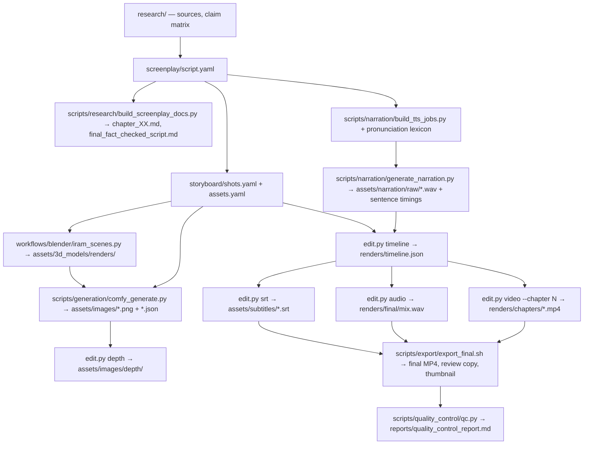

# Production workflow (reproducible, resumable)

Every stage writes files to disk and skips work that already exists. To redo a stage, delete its outputs.



## Commands

```bash
P=<project dir>; WORK=/home/user/iram-work
# script docs and TTS jobs
python3 $P/scripts/research/build_screenplay_docs.py
python3 $P/scripts/narration/build_tts_jobs.py qwen3
# narration (about 2 h on 4 CPU cores)
$WORK/venvs/qwen/bin/python -I $P/scripts/narration/generate_narration.py
# images (ComfyUI must be running, see installation.md)
$WORK/venvs/comfy/bin/python $P/scripts/generation/comfy_generate.py            # all assets in storyboard/assets.yaml
# blender layouts and schematic
$WORK/venvs/blender/bin/python -I $P/workflows/blender/iram_scenes.py --scene columns --view 1 --out $P/assets/3d_models/renders --res 1344x768 --samples 32 --still --exposure -2.5
# edit
source $WORK/venvs/ml/bin/activate
python $P/scripts/editing/edit.py depth
python $P/scripts/editing/edit.py timeline
for c in 0 1 2 3 4 5 6 7; do python $P/scripts/editing/edit.py video --chapter $c & done; wait
python $P/scripts/editing/edit.py audio
python $P/scripts/editing/edit.py srt
bash $P/scripts/export/export_final.sh
python $P/scripts/quality_control/qc.py
```

## Changing the film

- **Wording:** edit `screenplay/script.yaml`, re-run the claim check (`claim_verification_matrix.csv`), delete `assets/narration/raw/<seg>.*` for the changed segments, and re-run narration, timeline, video, audio and srt.
- **A picture:** edit the prompt in `storyboard/assets.yaml`, delete `assets/images/<ID>.png`, and re-run `comfy_generate.py <ID>` and `edit.py depth`.
- **Shot order, moves or durations:** edit `storyboard/shots.yaml`, then re-run timeline, video and audio.
- **Pronunciation:** edit `configuration/pronunciation_lexicon.yaml`, then re-run `build_tts_jobs.py` and the affected segments.
