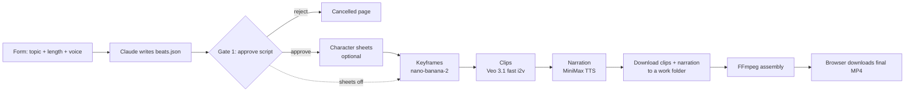

# n8n workflow: Zack D-style 3D short generator

[`zackd-video-generator.workflow.json`](zackd-video-generator.workflow.json) runs the same pipeline as the Python scripts in this repo, but as one n8n workflow with a web form in front of it.



| Repo script | Workflow node(s) |
| --- | --- |
| `script_generator.py` | **Write script (Claude)** → **Parse beats.json** |
| (GATE 1 in `SKILL.md`) | **Approve script** form page |
| `character_sheets.py` | **Character sheet jobs** → **Render character sheets** |
| `keyframes.py` | **Keyframe jobs** → **Render keyframes** |
| `clips.py` | **Clip jobs** → **Animate clips** |
| `audio.py` | **Narration job** → **Narrate** |
| `download_file()` | **Create work folder** → **Media to download** → **Download media** → **Save media** |
| `assemble.py` | **Probe narration length** → **Build ffmpeg command** → **Render final.mp4** |
| `provider.py` `_submit_and_poll` | **MuAPI job runner** sub-workflow (bottom row) |

Each MuAPI call goes through the job runner at the bottom of the canvas. It submits to `https://api.muapi.ai/api/v1/<endpoint>`, polls `/predictions/<id>/result` every 10 s for up to 15 min, and returns `{ tag, url }`. The render nodes call it with `$workflow.id`, so you import only one file.

## Requirements

- **Self-hosted n8n 1.x or 2.x.** The final step runs `ffmpeg`, so n8n Cloud cannot run it.
- **`ffmpeg` and `ffprobe`** on the n8n host's `PATH`.
- **The Execute Command node turned on.** n8n 2.x turns it off by default. Set `NODES_EXCLUDE=[]` (or a list without `n8n-nodes-base.executeCommand`).
- **A MuAPI API key** ([muapi.ai](https://muapi.ai)) and an **Anthropic API key**.

### Docker

The official `n8nio/n8n` image has no package manager, so copy in static ffmpeg binaries:

```dockerfile
FROM n8nio/n8n:latest
COPY --from=mwader/static-ffmpeg:7.1.1 /ffmpeg /ffprobe /usr/local/bin/
```

```yaml
# docker-compose.yml
services:
  n8n:
    build: .
    ports: ["5678:5678"]
    environment:
      - NODES_EXCLUDE=[]
    volumes:
      - n8n_data:/home/node/.n8n
      - ./videos:/home/node/.n8n-files/zackd   # finished MP4s land here
volumes:
  n8n_data:
```

## Setup

1. In n8n, go to **Workflows → Import from file** and choose `zackd-video-generator.workflow.json`.
2. Create two credentials:
   - **Header Auth**: name `x-api-key`, value is your MuAPI key. Select it in **Submit MuAPI job** and **Get job result**.
   - **Anthropic**: your Anthropic key. Select it in **Write script (Claude)**.
3. **Save** the workflow. The render nodes call it by its own ID, so it must be saved first.
4. **Publish / activate** it, then open the production URL of **Video request form**.

## Using it

1. Type a curiosity question, for example *"What happens when you swallow gum?"*, and pick a length (3, 5 or 7 beats).
2. Read the script on the next page. Choose **Approve and render** to spend credits, or **Reject**.
3. Keep the tab open. A 5-beat short makes about 10 keyframes and 10 Veo clips, one at a time, so expect 10 to 30 minutes. When it finishes, the browser downloads the MP4. A copy stays in `/home/node/.n8n-files/zackd/`.

## Settings (the Config node)

| Field | Default | Notes |
| --- | --- | --- |
| `claudeModel` | `claude-sonnet-5-5` | Use `claude-opus-5-5` for stronger scripts. |
| `imageEndpoint` | `nano-banana-2` | Text-to-image model for keyframes. |
| `imageEditEndpoint` | *(empty)* | Set this to a MuAPI image-edit model to turn on character sheets. Keyframes then send the sheets as references. |
| `referenceImagesField` | `images_list` | Payload field name for those reference URLs. Check the edit model's docs. |
| `videoEndpoint` | `veo3.1-fast-image-to-video` | Use `veo3.1-image-to-video` for higher quality at a higher cost. |
| `ttsEndpoint` / `voiceId` / `speechSpeed` | `minimax-speech-2.6-turbo` / `male_doc_fast` / `1.1` | The form's **Voice ID** field overrides `voiceId`. |
| `transitionDuration` | `0.35` | Set to `0` for hard cuts. |
| `bgmPath` | *(empty)* | Optional music file on the n8n host, for example `/home/node/.n8n-files/music/bed.mp3`. It loops at 15 % volume under the narration. |
| `outputDir` | `/home/node/.n8n-files/zackd` | Must be inside `N8N_RESTRICT_FILE_ACCESS_TO` (n8n 2.x default: `~/.n8n-files`). |

## How assembly differs from `assemble.py`

- n8n downloads every clip and the narration first, so ffmpeg reads only local files. The work folder is deleted after the render.
- It uses the same canvas (720×1280 at 30 fps), the same impact-zoom crop and the same transition cycle (`fade → wipeleft → slideleft → circleopen`).
- The soundtrack is the narration (plus the optional music). Veo's generated clip audio is dropped.
- Shot lengths are scaled so the cut ends with the narration, capped at 7.5 s per clip. If the narration is still longer, the last frame holds.

## Notes

- Character sheets are off by default. The Python scripts make sheets but never send them to the image model. Here, keyframes repeat each character's description in the prompt instead, which costs no extra credits. To use real reference images, set `imageEditEndpoint`.
- Each run gets a unique name, `<topic_slug>_<executionId>`, so runs never overwrite each other.
- If a MuAPI job fails or runs past 15 minutes, the execution stops with the endpoint, the shot ID and MuAPI's error message.
